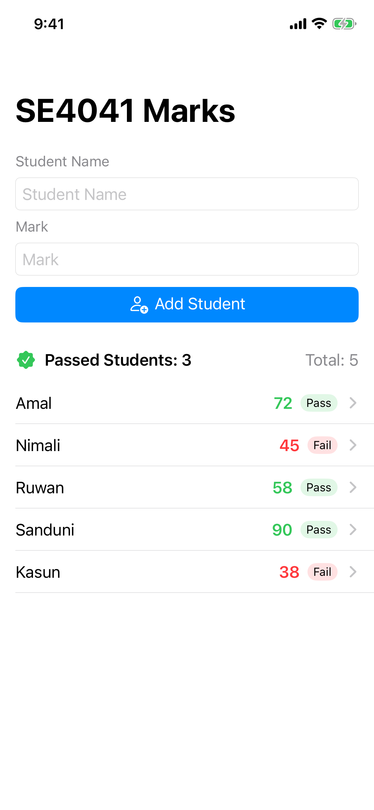

# SE4041 – Practical 04: Building Your First iOS App with SwiftUI

SE4041 Marks – a SwiftUI iPhone app that adds students with their marks, shows pass/fail, opens a detail screen for each student and counts the passed students.

**Name:** Abisheak S  
**Student ID:** IT21244384

## Screenshots

